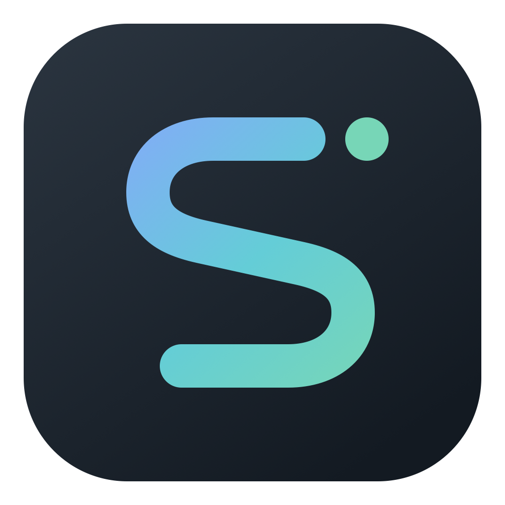
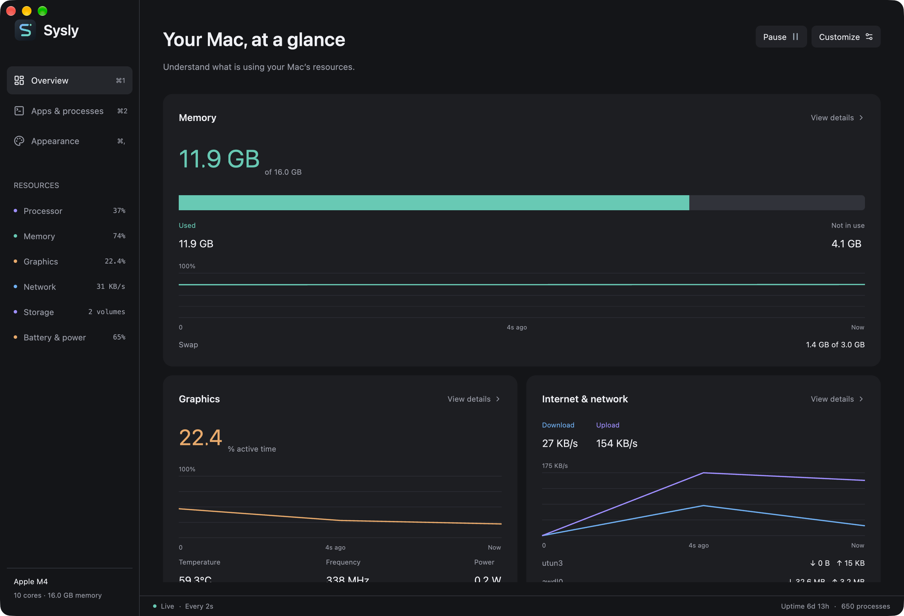

<p align="center">
  
</p>

# Sysly

A native system monitor for Apple Silicon Macs, built with Rust and GPUI.

See what is using your Mac's resources, inspect individual processes, and arrange the dashboard around the readings you care about. Sysly keeps CPU and memory summaries in the menu bar when you close the window.

**[Download Sysly for Apple Silicon](https://github.com/darshmahadevia/sysly/releases/download/v0.1.0/Sysly.zip)** · [Release notes](https://github.com/darshmahadevia/sysly/releases/tag/v0.1.0)

Requires an Apple Silicon Mac and macOS 14 or later. Intel Macs are not supported. The download is a prebuilt app; you do not need Rust or Xcode.



## Engineering highlights

- Cut median foreground CPU use from 25.52% to 2.58% of one core in a recorded five-session-per-build comparison by making charts sample-driven and avoiding repeated dashboard work.
- Built native resource monitoring and process controls with Rust, GPUI, and macOS APIs. A separate action worker keeps process controls independent of hardware sampling waits.
- Bounded chart history to 902 samples and kept only the latest collector snapshot, so a slow interface does not accumulate a queue of old readings.
- Added native verification for process search, inspection, confirmed signals, pause and resume, and menu bar reopening. Collector checks compare readings with macOS and a known 16 MiB loopback transfer.

The CPU result covers short foreground Overview sessions on one 10-core Apple Silicon Mac. It is not a general hardware or long-running performance claim. See the [measurement method and limits](docs/performance.md), [raw results](docs/performance-results.json), and [architecture](docs/architecture.md).

## Install

1. Download and unzip `Sysly.zip`.
2. Drag `Sysly.app` to **Applications**, then open it.

This preview is ad-hoc signed and is **not notarized by Apple**. macOS may block the first launch. If you trust this release, try opening Sysly once, then go to **System Settings > Privacy & Security > Open Anyway** and confirm. See [Apple's instructions for opening an unnotarized app](https://support.apple.com/en-us/102445).

Closing the window keeps Sysly in the menu bar. Use **Quit Sysly** in its menu to exit.

For bugs, include your Mac model, macOS version, and steps to reproduce in a [GitHub issue](https://github.com/darshmahadevia/sysly/issues).

## Build from source

You need an Apple Silicon Mac with macOS 14 or later, Rust 1.88 or newer, and the Xcode Command Line Tools.

If you have not installed the Command Line Tools, run:

```sh
xcode-select --install
```

Clone the repository and build the app:

```sh
git clone https://github.com/darshmahadevia/sysly.git
cd sysly
scripts/bundle.sh
open dist/Sysly.app
```

## Why I built it

I wanted a GUI for btop. I like having system activity and process controls in one place, and I wanted that experience in a native Mac window. Sysly is my take on that idea, with charts, a searchable process list, and a menu bar summary.

The monitor should leave resources for the work it is watching. I chose Rust to keep control over memory and runtime costs, and GPUI to build the interface without a webview. That choice is a starting point. Keeping Sysly light also means measuring the app and removing work it does not need to do.

## How Sysly limits overhead

Charts update when a sample arrives by default. Redrawing the whole dashboard at the display refresh rate spent CPU time without collecting any new readings. You can enable **Smooth chart scrolling** in **Appearance > Charts & menu bar** if you prefer continuous motion. Sampling and process controls work in either mode.

The collection and rendering paths also avoid repeated work:

- Charts share bounded history and read points directly. They no longer copy the history and each core's readings or build temporary point arrays for every frame.
- The overview finds its five busiest processes once per sample. It no longer sorts the entire process list every time the window redraws.
- The process page builds its search and sort results when you open it or its data changes. Name sorting converts each name to lowercase once per sort.
- User names are cached by user ID for 60 seconds. Commands are assembled into one string, and counter cleanup reuses existing process and interface indexes.
- The sampler keeps one latest snapshot. Interruptible waits let it respond to a reopened window or shorter refresh interval. Closing the window slows collection to at most once every five seconds. Pausing stops collection after any in-flight read finishes.

These changes reduce redraws, temporary allocations, and repeated lookups. Native window buffers, fonts, and GPU rendering still have a memory cost. Sysly does not claim btop's memory footprint or complete feature parity. See the [overhead measurements](docs/performance.md) for measured results and their limits.

On the test Mac, median foreground CPU use fell from 25.52% to 2.58% of one core across five sessions per build. Whole-app memory changed modestly, with physical footprint at 267.1 MiB before and 264.5 MiB after.

## What you can do

- Track CPU and per-core activity, GPU activity, memory, swap, disk I/O, network traffic, and battery status.
- Read temperatures, frequencies, power estimates, and fan speeds where your hardware exposes them.
- Search processes by name, PID, or user. Sort the list, browse a process tree, and inspect commands and resource use.
- Terminate, force quit, pause, or resume a process after confirmation, within your account's permissions.
- Drag dashboard sections into place, change their width, resize charts, and edit labels and descriptions.
- Choose colors and fonts, save named layouts, and import or export themes and layouts.
- Adjust the history window, refresh rate, display density, and menu bar readings.

Missing hardware readings appear as unavailable.

## Build details

The script creates `dist/Sysly.app` and `dist/Sysly.zip`. It signs the app with an ad-hoc signature. A download that passes Apple's normal Gatekeeper checks requires Developer ID signing and notarization; the preview does not have either.

Before publishing a release, verify the ZIP and write its SHA-256 checksum:

```sh
python3 scripts/verify_release.py
```

The verifier extracts the app outside the workspace, checks its bundle metadata, Apple Silicon architecture, and signature, and runs its sampling CLI. macOS File Provider can reattach Finder metadata in synced folders and invalidate strict signature checks on an otherwise valid app.

For development, launch the app directly:

```sh
cargo run --locked
```

Sysly uses GPUI 0.2.2 and gpui-component 0.5.1. GPUI's `runtime_shaders` feature lets the app build with Command Line Tools.

## Customize the dashboard

Press `Command-,` to open Appearance. In **Layout & text**, drag sections into a new order, adjust their size, and edit dashboard copy. The other tabs control colors, fonts, chart history, refresh rate, and the menu bar.

Use `Command-1` for Overview, `Command-2` for Apps & processes, and `Command-F` for process search. The [dashboard guide](docs/dashboard.md) covers navigation and customization.

Try the [included themes](themes/), or export your own. Themes store colors, font family, and text size. Layouts store section order, visibility, widths, chart heights, labels, and descriptions. A selected local font file stays on your Mac.

Settings live at `~/Library/Application Support/Sysly/preferences.json`. If settings are malformed, Sysly uses defaults and backs up the original file before the next save. Set `SYSLY_CONFIG_DIR` to use a different settings directory.

## Understand the readings

CPU activity shows the percentage of the Mac's total CPU capacity in use. Individual process CPU activity is per core and can exceed 100%. GPU activity measures active residency, not rendering speed.

Memory readings follow macOS counters. Available memory includes reclaimable memory, so used and available memory do not add up to total memory. Memory use alone does not indicate memory pressure.

Network rates use the actual time between samples. The first sample establishes a baseline. Interface totals come from macOS and do not start at zero when you open Sysly. APFS volumes can share physical disk I/O counters, so do not add their throughput together.

Hardware readings depend on the Mac and macOS version. Power readings are estimates. Sysly uses [macmon](https://github.com/vladkens/macmon) for Apple Silicon hardware data, including private Apple interfaces. Support for every chip and macOS version needs separate verification.

## Develop and verify

Run the tests and lint checks:

```sh
cargo test --locked
cargo clippy --locked --all-targets -- -D warnings
```

To compare two release builds in alternating native GUI sessions, run:

```sh
python3 scripts/compare_overhead.py /path/to/baseline/sysly target/release/sysly
```

The script launches five sessions per build with isolated settings. It records CPU time, resident memory, and physical footprint. It needs the compiled `target/sysly-ui` helper and macOS automation permissions. Stop other Sysly instances and builds before measuring.

Check the collectors against real macOS activity:

```sh
python3 scripts/verify_metrics.py
```

The metric check compares memory and core counts with macOS, creates a CPU workload, and checks a known loopback transfer.

To print five JSON snapshots at one-second intervals, build the release binary and run:

```sh
cargo build --release --locked
target/release/sysly --sample 5 1
```

Snapshots include process commands. Treat them as local diagnostic data.

For native interaction checks, run `python3 scripts/verify_gpui.py PID` against a running Sysly instance. The script needs macOS Accessibility and screen capture permissions. It compiles Swift helpers and reads captured window text with Vision OCR because GPUI 0.2.2 does not expose content labels through Accessibility. Process signal checks use a disposable child process.

Read the [architecture guide](docs/architecture.md) for code ownership and data sources, or the [verification notes](docs/verification.md) for recorded results and limits.

## License

Sysly uses the [MIT license](LICENSE). The vendored macmon code carries its [own MIT license](vendor/macmon/LICENSE).
